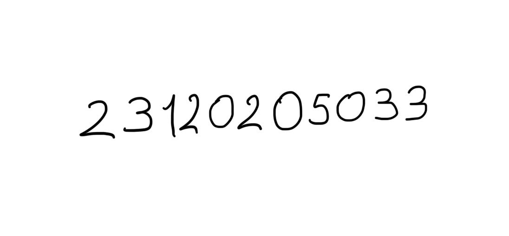

# MNIST Handwritten Digit Recognition with an MLP

Deep Learning course, Assignment 1, İstanbul Medeniyet University
İsa Mirza Sincap, 23120205033

In this assignment I trained a Multi-Layer Perceptron (no CNN) from scratch on MNIST using TensorFlow/Keras. I compared several hyperparameter settings and then tested the model on my own handwritten student number.

## Files

| File | Description |
|---|---|
| `mnist_mlp.ipynb` | All code, outputs, plots and the evaluation (in Turkish) |
| `numara.jpg` | Photo of my student number, written by hand |

## How to run

1. Open `mnist_mlp.ipynb` in Google Colab. A CPU runtime is enough.
2. Upload `numara.jpg` to the Colab files panel (`/content`).
3. Choose Runtime → Run all.

All the libraries used (TensorFlow, scikit-learn, scikit-image, SciPy, Pillow, Matplotlib) come preinstalled in Colab.

## Data split

| Set | Size | Source |
|---|---|---|
| Train | 48,000 | 80% of the MNIST training set (stratified) |
| Validation | 12,000 | 20% of the MNIST training set (stratified) |
| Test | 10,000 | Official MNIST test set, used only once at the end |

Pixels are scaled to [0, 1], and each 28×28 image is flattened to a 784-dimensional vector.

## Experiment 1: Base MLP

| Hyperparameter | Value |
|---|---|
| Architecture | 784 → 128 (ReLU) → 64 (ReLU) → 10 (Softmax) |
| Loss | Sparse categorical cross-entropy |
| Optimizer | Adam, learning rate 0.001 |
| Batch size | 64 |
| Epochs | 15 |
| Seed | 33 |

| Metric | Value |
|---|---|
| Training loss | 0.0130 |
| Validation loss | 0.1324 |
| Training accuracy | 0.9958 |
| Validation accuracy | 0.9747 |
| Test accuracy | 0.9742 |
| Training time | 61.0 s (Colab CPU) |

Validation loss is lowest at epoch 4 and rises after that, while training loss keeps going down. The model starts to overfit after a few epochs, but validation accuracy stays around 0.97.

## Hyperparameter comparison

Each run changes exactly one setting from the base model. Values are from the last epoch.

| Run | Train loss | Val loss | Train acc | Val acc | Time |
|---|---|---|---|---|---|
| Base | 0.0130 | 0.1324 | 0.9958 | 0.9747 | 61.0 s |
| 3 hidden layers (256-128-64) | 0.0151 | 0.1083 | 0.9948 | **0.9770** | 99.0 s |
| Batch size 256 | 0.0163 | 0.1059 | 0.9966 | 0.9715 | 31.3 s |
| Sigmoid activation | 0.0171 | 0.0834 | 0.9972 | 0.9757 | 64.5 s |
| SGD, lr 0.01 (no momentum) | 0.1538 | 0.1604 | 0.9559 | 0.9522 | 49.6 s |
| Adam, lr 0.01 | 0.0711 | 0.1908 | 0.9826 | 0.9683 | 59.3 s |

I picked the final model by validation accuracy alone: the 3-hidden-layer model. Its **test accuracy is 0.9781**. The digits it confuses most often are 5→3, 9→4 and 6→5.

## My own handwriting

Steps to make the photo look like MNIST: grayscale, invert (MNIST uses a black background with white digits), local thresholding, splitting the digits using empty columns, normalizing stroke thickness, fitting each digit into a 20×20 box while keeping its aspect ratio, placing it on a 28×28 canvas centered by center of mass, and scaling to [0, 1].

| Preprocessing | Prediction | Correct |
|---|---|---|
| Direct resize to 28×28 | `26955213536` | 3 / 11 |
| MNIST-style preprocessing | `23120205033` | **11 / 11** |

## Conclusion

The MLP reaches about 97.8% accuracy on the MNIST test set. On my own handwriting, though, it got only 3 of 11 digits right when the images were simply resized: the digits filled the whole frame, were stretched and had much thicker strokes than in MNIST. After preprocessing the images the same way MNIST was prepared, all 11 digits were correct. This shows the effect of distribution shift: the model learns what the training images look like. An MLP is also sensitive to the position and size of a digit, so real-world inputs have to be brought close to the training distribution. Eleven digits is a small sample, so this result should not be generalized too far.
